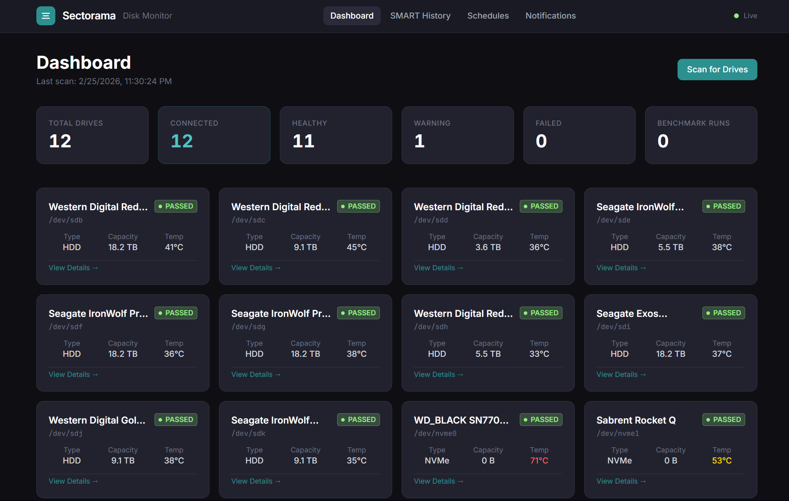
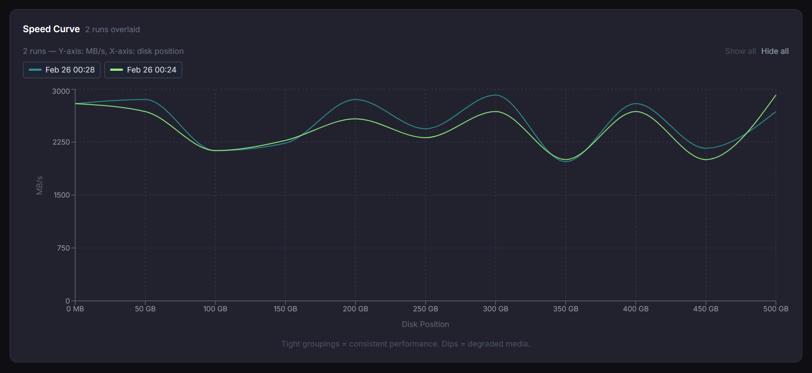
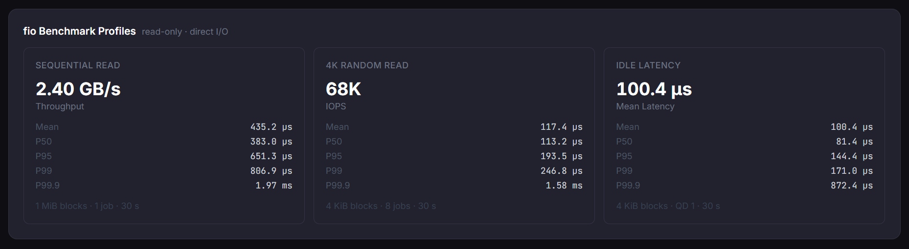

<div style="text-align: center;">
  
  <br/><br/>
  <strong>Self-hosted disk benchmark and health monitor.</strong>
  <br/>
  Sectorama discovers your drives, runs comprehensive fio benchmarks (position curve + I/O profiles), polls SMART
  attributes on a schedule, and surfaces everything through a clean React dashboard — all from a single Docker container
  on your own hardware.
</div>

[](https://github.com/tabilzad/sectorama/actions/workflows/ci.yml)
[](https://hub.docker.com/r/tabilzad/sectorama)
[](https://www.gnu.org/licenses/gpl-3.0)
---

<div style="text-align: center;">
  
  <p><em>Dashboard showing 12 drives with live SMART health badges, temperatures, type, and capacity at a glance.</em></p>
</div>

<div style="text-align: center;">
  
  <p><em>Historical speed curve to track performance overtime </em></p>
</div>

<div style="text-align: center;">
  
  <p><em>Latency, sequential and random read statistics</em></p>
</div>

---

## Features

- **Drive discovery** — auto-detects all block devices via `smartctl --scan`
- **Storage overview** — total, used and free space per drive class (hard drives / SATA SSDs / NVMe) on the
  dashboard; see [Storage usage](#storage-usage) for the one mount it needs
- **Position curve** — measures sequential read speed at evenly-spaced byte offsets to visualise the speed falloff
  from outer to inner tracks. Sample parameters are drive-type aware: QD 32 / 256 MiB per sample on NVMe,
  QD 1 / 128 MiB on HDD and SATA SSD
- **fio profiles** — four uniform profiles per run, identical parameters on every drive type so results are
  directly comparable across devices:
    - Sequential read, 1 MiB blocks, QD 1 — single-stream throughput (typical NAS workload)
    - Sequential read, 1 MiB blocks, QD 32 — deep-queue throughput (saturates NVMe bandwidth)
    - Random read, 4 KiB blocks, QD 1 — latency-sensitive baseline
    - Random read, 4 KiB blocks, QD 32 — peak IOPS (matches CrystalDiskMark Q32T1)

  Each profile runs for 30 s (plus 5 s ramp) with `O_DIRECT` and a fixed random seed, pinned to a
  middle-of-disk region to eliminate outer-track bias. Latency percentiles (P50 / P95 / P99 / P99.9) are
  recorded per profile. All benchmark I/O is strictly read-only, and only one benchmark runs at a time
  so concurrent jobs can never distort each other's results
- **SMART history** — scheduled polling stored in InfluxDB; attribute trends charted over time. Polls skip
  drives that are in standby so monitoring never spins a disk up, and query only a few drives at a time;
  interval, concurrency and the standby rule are all set from the Settings page
- **Benchmark schedules** — cron-based per-drive or global schedules
- **Notifications** — alert channels (Webhook, Slack) with per-alert-type subscriptions; transition-only firing (once on
  condition onset, silent until it clears and re-triggers); per-drive temperature threshold overrides
- **Live feed** — WebSocket push for real-time benchmark progress and health alerts
- **Dark UI** — React + Tailwind dashboard; fully responsive

---

## Quick Start (Docker Compose)

### 1. Copy the compose file

```bash
curl -O https://raw.githubusercontent.com/tabilzad/sectorama/master/docker-compose.prod.yml
```

### 2. Set required secrets

```bash
export INFLUXDB_TOKEN=change-me-strong-random-secret
# optional — defaults shown
export INFLUXDB_ADMIN_PASSWORD=adminpass
export SMART_POLL_INTERVAL_MINUTES=5
export BENCHMARK_NUM_POINTS=11
```

### 3. Start

```bash
docker compose -f docker-compose.prod.yml up -d
```

Open **http://localhost:8888**, click **Scan for Drives**, then run a benchmark from any drive's detail page.

> **Note:** The container runs `privileged` and mounts `/dev` read-only so that `smartctl` and `fio` can access raw
> block devices. Do not expose port 8888 to the public internet.

---

## Install on Unraid

[`docker-compose.unraid.yml`](docker-compose.unraid.yml) is the Quick Start stack adapted to Unraid. It runs Sectorama
together with its InfluxDB database and differs from the generic file in three ways:

- data lives under `/mnt/user/appdata` instead of in Docker volumes inside `docker.img`
- the array status is mounted, so the dashboard's [Storage](#storage-usage) panel shows per-disk usage out of the box
- the app container carries the labels that give it an icon and a **WebUI** link on the Docker tab

Any compose front end works: the **Docker Compose Manager** plugin from Community Applications, a **Portainer** stack,
or `docker compose` over SSH.

1. Create a stack named `sectorama` and paste the contents of `docker-compose.unraid.yml` as its compose file
   (Compose Manager: **Add New Stack**, then **Edit Stack → Compose File**).
2. Add the stack's environment variables (Compose Manager: **Edit Stack → ENV File**; Portainer:
   **Environment variables**):

   ```ini
   # Required. Any long random string, e.g. the output of: openssl rand -hex 32
   INFLUXDB_TOKEN=change-me-long-random-string
   # Optional. Benchmark schedules follow this time zone (default: UTC)
   TZ=Europe/Berlin
   # Optional. Login for the bundled InfluxDB's own UI (default: adminpass)
   INFLUXDB_ADMIN_PASSWORD=change-me
   ```

3. Start the stack (Compose Manager: **Compose Up**), open `http://<server-ip>:8888` and click **Scan for Drives**.

| Folder                                 | Contents                                                     |
|----------------------------------------|--------------------------------------------------------------|
| `/mnt/user/appdata/sectorama`          | SQLite database: drive registry, schedules, alerts, settings |
| `/mnt/user/appdata/sectorama-influxdb` | InfluxDB data: SMART history and benchmark results           |

Things to know:

- **InfluxDB needs no manual setup.** The stack creates the organisation, bucket and token on the first start and does
  not publish the database on the host; only Sectorama talks to it. The token, the admin password and the retention
  period are applied on that first start only, so choose the token once: changing it later makes Sectorama send a
  token the initialised database does not know.
- **Stay on InfluxDB 2.x.** Sectorama queries with Flux, which InfluxDB 3 does not support. To use an InfluxDB 2.x
  instance that is already running, delete the `influxdb` service and the app's `depends_on` block, then set the
  app's `INFLUXDB_URL`, `INFLUXDB_ORG`, `INFLUXDB_BUCKET` and `INFLUXDB_TOKEN` to match it.
- **Sleeping disks stay asleep.** SMART polls skip drives in standby by default. A benchmark has to read from the
  drive, so it spins the disk up; keep that in mind when scheduling benchmarks.
- **The container is privileged.** `smartctl` and `fio` need raw access to the block devices. All benchmark I/O is
  read-only.
- **Port 8888 already in use?** Change the left-hand side of the port mapping, for example `"8890:8888"`.
- **Updating.** Pull the new images and recreate the stack: **Update Stack** in Compose Manager, or
  `docker compose pull && docker compose up -d`.

---

## Development Setup

```bash
# 1. Clone
git clone https://github.com/tabilzad/sectorama.git
cd sectorama

# 2. Install workspace dependencies
npm install

# 3. Start just the InfluxDB 
docker compose -f docker-compose.dev.yml up -d

# 4. Configure environment for node
cp .env.example .env
# On Windows/macOS: add DISK_DISCOVERY_MOCK=true to .env

# 5. Run (backend :8888, frontend :5173 with HMR)
npm run dev
```

### Build

```bash
npm run build       # compiles shared → backend → frontend
npm run typecheck   # type-check all workspaces without emitting
npm test            # backend unit + API validation tests
```

---

## Environment Variables

| Variable                              | Default                 | Description                                                       |
|---------------------------------------|-------------------------|-------------------------------------------------------------------|
| `PORT`                                | `8888`                  | HTTP port the backend listens on                                  |
| `SQLITE_PATH`                         | `./sectorama.db`        | Path to the SQLite database file                                  |
| `INFLUXDB_URL`                        | `http://localhost:8086` | InfluxDB v2 base URL                                              |
| `INFLUXDB_TOKEN`                      | _(required)_            | InfluxDB API token                                                |
| `INFLUXDB_ORG`                        | `sectorama`             | InfluxDB organisation                                             |
| `INFLUXDB_BUCKET`                     | `sectorama`             | InfluxDB bucket                                                   |
| `INFLUXDB_ADMIN_PASSWORD`             | `adminpass`             | Admin password for the bundled InfluxDB service                   |
| `DISK_DISCOVERY_MOCK`                 | `false`                 | Return synthetic drives/SMART/benchmark data (Windows/macOS dev)  |
| `TZ`                                  | `UTC`                   | Time zone that benchmark schedules follow, e.g. `Europe/Berlin`   |
| `STORAGE_MOUNT_ROOT`                  | `/mnt`                  | Filesystems mounted under this path are measured for used / free  |
| `UNRAID_EMHTTP_DIR`                   | `/var/local/emhttp`     | Directory holding Unraid's `disks.ini`; used instead when present  |
| `SMART_POLL_INTERVAL_MINUTES`         | _(unset)_               | Pins the SMART poll interval (see [Settings](#settings))          |
| `SMART_POLL_CONCURRENCY`              | _(unset)_               | Pins the number of drives queried at the same time                |
| `BENCHMARK_NUM_POINTS`                | _(unset)_               | Pins the default number of positions sampled per run              |
| `TEMPERATURE_ALERT_THRESHOLD_CELSIUS` | _(unset)_               | Pins the default temperature alert threshold                      |

---

## Settings

Polling, benchmark and temperature defaults live on the **Settings** page and are stored in SQLite, so they survive
restarts and need no redeploy to change:

| Setting                 | Default | Notes                                                                                   |
|-------------------------|---------|-----------------------------------------------------------------------------------------|
| Skip drives in standby  | on      | Scheduled polls never spin a sleeping disk up                                           |
| Poll interval           | 5 min   | Takes effect immediately; the poller is rescheduled without a restart                   |
| Drives polled at once   | 4       | Upper bound on simultaneous `smartctl` processes                                        |
| Default sample points   | 11      | Used by manual runs and new schedules that do not choose their own value                |
| Temperature defaults    | 25 / 40 / 50 / 60 °C | Zones for drives without per-drive settings; the Warm → Hot boundary (50) is the alert threshold |

The last four can also be **pinned** with the environment variables in the table above. A non-blank value wins over
the UI and the field is shown read-only with the variable's name; unset or blank it to hand control back to the UI.
The compose files pass the variables through from `.env` as blank-by-default, so an existing `.env` keeps working.

---

### Data stores

| Store                         | What lives there                                                                                                                        |
|-------------------------------|-----------------------------------------------------------------------------------------------------------------------------------------|
| **SQLite** (`better-sqlite3`) | Drive registry, benchmark run metadata, schedules, latest SMART cache, notification channels, subscriptions, per-drive alert thresholds |
| **InfluxDB v2**               | SMART attribute history, benchmark speed points, benchmark profile results                                                              |

---

## Storage usage

The dashboard's **Storage** panel groups drives by class (hard drives, SATA SSDs, NVMe) and shows raw capacity
alongside used / free space. Raw capacity comes from the drive registry. Used and free come from the host's
filesystems, which the container can only measure when they are visible inside it:

| Host           | Add to the container's volumes                                        | What is measured                                                                                                            |
|----------------|-----------------------------------------------------------------------|-----------------------------------------------------------------------------------------------------------------------------|
| Unraid         | `/var/local/emhttp:/var/local/emhttp:ro`                              | Per-disk size / used / free straight from the array status (`disks.ini`). No data mounts needed; parity and flash are skipped |
| Any Linux host | `/mnt:/mnt:ro` (or whichever paths you want, under `STORAGE_MOUNT_ROOT`) | Every filesystem on a real block device under that root, measured with `statfs` and attributed to a drive class through sysfs |

Both lines are present, commented out, in the compose files; `docker-compose.unraid.yml` ships with the Unraid
line enabled. Filesystems whose backing drive cannot be identified
(pools that expose no member information in sysfs) appear as **Other pools**. Without either mount the panel still
shows raw capacity per class and explains how to enable usage.

---

## Drive health

The badge on a drive card, the stats counters and the header on the drive page all use the same rule:

| Badge     | Meaning                                                                                                                                              |
|-----------|------------------------------------------------------------------------------------------------------------------------------------------------------|
| `FAILED`  | The drive's overall SMART self-assessment is FAILED                                                                                                  |
| `WARNING` | The drive still passes, but something deserves attention: reallocated or uncorrectable sectors (NVMe media errors), more than 5 pending sectors, an attribute the device flags as failing (e.g. ATA "in the past"), or an advisory attribute such as NVMe wear ≥ 90 % |
| `PASSED`  | Passes with nothing raised                                                                                                                           |
| `UNKNOWN` | No SMART reading yet                                                                                                                                 |

---

## Notifications

Sectorama can push alerts to external services when a drive's health or temperature crosses a threshold.

### Alert types

| Type                 | Fires when…                                                              |
|----------------------|--------------------------------------------------------------------------|
| `smart_error`        | SMART self-assessment transitions from passing → failing                 |
| `smart_attribute`    | A predictive counter grows (reallocated, pending or uncorrectable sectors; NVMe media errors), an attribute starts reporting failure (ATA `when_failed`, NVMe critical warning or spare below threshold), or an advisory attribute needs attention (e.g. NVMe wear ≥ 90 %) |
| `temperature`        | Drive temperature transitions from at-or-below the threshold to above it; the recovery below it is sent to the same channels |
| `drive_missing`      | A registered drive is no longer listed by the host (checked before every SMART poll and at startup); its return is sent to the same channels |
| `benchmark_complete` | A scheduled benchmark run finishes (completed or failed), with a summary report |

Alerts are **transition-only**: they fire once when a condition first occurs and are silent until the condition clears
and re-triggers. This prevents alert storms on every poll.

Every alert is recorded in the **alert history** (Notifications page, `GET /api/v1/notifications/history`) together
with the delivery state per channel. A delivery that fails is retried with increasing delays (1 min, 5 min, 15 min,
1 h, 6 h) before it is given up, and deliveries left pending by a restart are retried on startup, so a webhook outage
does not swallow a transition-only alert.

### Channel types

| Type      | Config fields                                     |
|-----------|---------------------------------------------------|
| `webhook` | URL + optional auth (None / Basic / Bearer token) |
| `slack`   | Slack Incoming Webhook URL (Block Kit formatting) |

Channels are managed from the **Notifications** page in the UI. Each channel can subscribe to any combination of alert
types. A test payload can be sent from the UI at any time.

### Temperature thresholds

The default zones and alert threshold for all drives are set on the **Settings** page (default alert at `50`°C;
pinnable with `TEMPERATURE_ALERT_THRESHOLD_CELSIUS`). Individual drives can override them from the
**Temperature Settings** section on the Drive Detail → SMART tab.

### Adding a new channel type

1. Create `packages/backend/src/services/notifications/channels/MyChannel.ts` implementing `INotificationChannel`
2. Add a `case 'mytype'` to `channelFactory.ts`
3. Add the new `ChannelType` to `@sectorama/shared`

No other files need to change.

---

## Contributing

Contributions are welcome. Please:

1. Fork the repository and create a branch from `master`
2. Make your changes and verify `npm run build && npm run typecheck` pass
3. Open a pull request — CI will run automatically on the PR

For larger changes, open an issue first to discuss the approach.

---

## License

Released under the [GNU General Public License v3.0](https://www.gnu.org/licenses/gpl-3.0).
